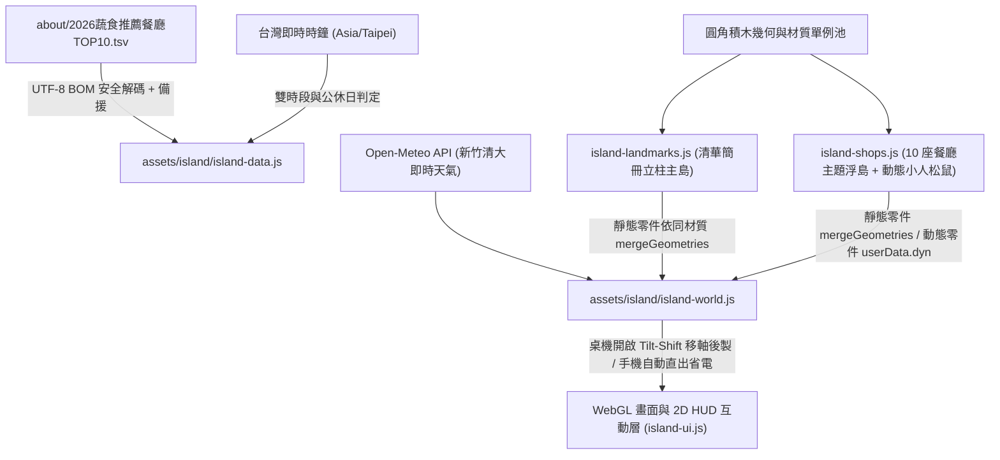

# 2026 清大福青社蔬食地圖（天空之城浮島 3D 互動網站）實作計畫（修訂第二版）

## 一、 專案目標與設計脈絡

本專案參考「南大附中探索群島」（`https://tntcshisland.vercel.app/`）之 3D 微縮群島導覽架構與原作者四項關鍵技術心法，結合 [VEG_MAP.jpg](file:///D:/xampp/htdocs/Other/NTHU_BWY_veggie/img/VEG_MAP.jpg) 的粉彩青瓷手繪散步地圖風格，為清大福青社蔬食活動打造 **「2026 清大福青社蔬食地圖：天空之城浮島」** 3D 互動探索網站。

系統整合 [2026蔬食推薦餐廳TOP10.tsv](file:///D:/xampp/htdocs/Other/NTHU_BWY_veggie/about/2026蔬食推薦餐廳TOP10.tsv) 全數 10 筆精選蔬食店家資料，以設有 **清華大學校門「簡冊立柱」** 的中央主島為核心，向外延伸內外雙環共 10 座懸浮於雲海中的主題餐廳浮島，兼顧「桌上精緻玩具微縮模型美感」與「幾十 KB 極速秒開、低 Draw Calls 高幀率流暢體驗」。

---

## 二、 原作者四點關鍵技術提醒之納入與計畫修訂

> [!TIP]
> 針對您提供的參考站作者「關鍵技術解密」四項提醒，我們已完成逐項檢核，並將原本遺漏的 **「移軸微縮後製（行動裝置自動關閉）」** 與 **「同材質靜態幾何合併（降低 75% 以上 Draw Calls）」** 等關鍵技術正式寫入本修訂版計畫：

| 原作者提醒項目 | 計畫調整狀態 | 本專案具體落地規格 |
| :--- | :---: | :--- |
| **1. 磚塊幾何建模：不使用任何外部 3D 模型檔** | **強化鎖定** | **嚴禁載入任何外部 GLTF / FBX / OBJ 模型檔**。全場 11 座浮島、清華簡冊立柱、10 家店鋪與招牌菜（湯麵碗、水果奶茶杯、鐵板煲、便當盒、水餃）、小人、單車與松鼠，100% 由程式碼圓角方塊（`RoundedBoxGeometry`）與基礎幾何參數化拼裝，搭配幾何/材質單例快取池（Singleton Cache Pool），全站程式碼僅數十 KB 秒開且低多邊形玩具風格完全統一。 |
| **2. 移軸微縮後製 (Tilt-Shift Postprocessing)** | **關鍵新增** | 於 `island-world.js` 新增 Three.js `EffectComposer` 微縮後製管線：**上下兩端柔和景深模糊 + 中央焦點清晰 + 色彩飽和度微幅提升 + 柔和暗角**，營造「擺在木桌上的精緻微縮模型」視覺錯覺；同時實作**行動裝置自動偵測降級**（手機/平板預設自動關閉後製以維持流暢省電，並於底部工具列提供「特效」手動開關）。 |
| **3. 3,600 個零件合併：保住 43+ FPS** | **關鍵新增** | 11 座浮島與雲橋零件總數預計達 3,000 個以上。於 `island-world.js` 引入 `BufferGeometryUtils.mergeGeometries` 實作 `bakeStaticGroup()`：每座浮島內部所有不獨立運動的靜態零件（岩塊底座、簡冊立柱、外牆、屋頂、樹木、靜態餐點）依**相同材質自動合併為單一 BufferGeometry**，僅標記 `userData.dyn = true` 之動態角色（行走小人、單車、松鼠、蒸氣）獨立更新，並改用每島單一包圍碰撞體進行滑鼠 Raycast 拾取，減少 **75% 以上 Draw Calls**。 |
| **4. 官網 Big5 解碼 & 個資遮蔽防線** | **情境對齊強化** | 1. **編碼防亂碼**：本專案無舊版 Big5 學校公告爬蟲，但針對 Windows 匯出之 TSV 檔案強制採用明確 `TextDecoder('utf-8')` 解碼並剝除 UTF-8 BOM（`\uFEFF`）與 `\r\n` 尾隨字元，杜絕跨平台欄位亂碼。 2. **公開 GitHub 個資與機密防線**：`NTHU_BWY_veggie` 綁定公開 GitHub 儲存庫；經稽核 `TOP10.tsv` 僅含公開餐廳商業資訊（零學生姓名與私人個資）。實作時嚴格隔離，絕不讀取或暴露專案內任何學員報名個資或工作人員通關碼設定，並確保 `.gitignore` 排除測試暫存目錄。 |

---

## 三、 需請使用者確認之設計決策 (User Review Required)

> [!IMPORTANT]
> 請確認以下 3 項架構預設值；若修訂後計畫符合預期，直接點擊 **Proceed** 即可啟動分階段開發：
> 1. **部署目錄與既有頁面整合方式（預設：新增 `island.html` 並於 `map.html` 提供切換入口）**：
>    * 於 `D:/xampp/htdocs/Other/NTHU_BWY_veggie/` 新增 `island.html` 與 `assets/island/` 模組，並在既有 [map.html](file:///D:/xampp/htdocs/Other/NTHU_BWY_veggie/map.html) 新增醒目入口按鈕切換至「3D 天空浮島地圖」（保留原 Google Maps iframe 地圖不覆蓋）。
> 2. **前端技術棧選型（預設：免編譯原生 ES Modules + Three.js `0.170.0` `importmap`）**：
>    * 直接使用 Three.js 官方標準模組（含 `OrbitControls`、`BufferGeometryUtils`、`EffectComposer`、`RoundedBoxGeometry`），零 `node_modules` 污染、免 `npm run build`，直接相容 XAMPP 與 GitHub Pages。
> 3. **階段紀錄檔 `island_project_notes.md` 落盤路徑（預設：專案根目錄與對話目錄雙軌同步）**：
>    * 每完成一個開發階段（Stage 2 至 Stage 6），立即寫入更新 `D:/xampp/htdocs/Other/NTHU_BWY_veggie/island_project_notes.md`（區分 `## 待辦事項 (TODO)` 與 `## 已完成事項 (Done)`）。

---

## 四、 系統架構與視覺規格細節

### 1. 系統模組與渲染管線架構圖

### 2. 中央主島：清華大學校門「簡冊立柱」純幾何積木規格（依 3 張實景附圖）
* **三柱並列階梯結構**：以 `RoundedBoxGeometry` 拼裝 3 根獨立垂直長方體立柱，柱間保留真實透空垂直縫隙（正面與斜角皆可看穿），柱頂高度呈階梯狀微幅遞減，呈現展開竹簡「簡冊」層次。
* **三段式水平凸出腰線**：每根立柱於約 `33%`、`66%` 高度與柱頂下方配置雙道環繞凸出水平線腳，最高主柱頂端配置細圓柱金屬避雷針。
* **材質與直排校名題字**：柱體採用暖象牙白微粗糙材質（`#f0ede3`），於主柱中段寬面貼附高解析 `CanvasTexture` 直排深墨黑書法字 **「國立清華大學」**。
* **基座與校園景觀**：下方鋪設深淺灰青色拼花石板廣場、環形修剪綠籬灌木、濃密榕樹群、微縮「成功湖」與「清大福青蔬食月」木質攤位，全數靜態結構合併為極少數 Draw Calls。

### 3. 10 座蔬食餐廳浮島空間配置與積木微縮模型

融合 [VEG_MAP.jpg](file:///D:/xampp/htdocs/Other/NTHU_BWY_veggie/img/VEG_MAP.jpg) 粉彩青瓷藍綠天空（`#9dc2c0` ~ `#cfe6e3`）與雙分類色系，每座浮島皆具備 **天空之城倒錐形多層岩塊底座 + 懸浮碎石 + 垂掛綠藤 + 獨立相位上下呼吸懸浮動畫**：

| 環別與標章色 | 編號 | 餐廳名稱 | 相對方位與高度 | 純基本幾何拼裝之微縮店鋪與招牌菜模型 |
| :--- | :---: | :--- | :--- | :--- |
| **內環：特別推薦** （深墨青標 `#233332`） | 1 | **雅素齋自然人文蔬食館** | 東南（`R=15, y=+0.6`） | 木質人文茶屋、藥膳湯麵大碗與冰鎮滷味拼盤積木模型 |
| **內環：特別推薦** （深墨青標 `#233332`） | 2 | **妙觀音素食** | 東北東（`R=15, y=+1.0`） | 暖紅招牌麵館、冒動態蒸氣紅燒湯麵碗與燈籠 |
| **內環：特別推薦** （深墨青標 `#233332`） | 3 | **安姆士** | 北北東（`R=15, y=+0.5`） | 清新輕食吧台、巨型漸層水果奶茶圓柱杯與養生拌飯碗 |
| **內環：特別推薦** （深墨青標 `#233332`） | 4 | **棗子樹** | 北北西（`R=15, y=+0.9`） | 綠意庭院小館、蛋煎粄條鐵板台與結滿紅棗之低多邊形果樹 |
| **內環：校內必吃** （深墨青標 `#233332`） | 5 | **鼎盛蔬食便當（清大風二）** | 西南（`R=14, y=+0.4`） | 風雲樓二樓圓弧餐廳意象、多格手作蔬食便當盒積木模型 |
| **外環：單車 10 分鐘** （胡蘿蔔橘 `#ea7a2e`） | 6 | **滿素圓** | 東南東（`R=25, y=+1.8`） | 溫馨家常麵館、紅油抄手碗與木盒便當積木模型 |
| **外環：單車 10 分鐘** （胡蘿蔔橘 `#ea7a2e`） | 7 | **一鮮素素食小館** | 北方（`R=25, y=+2.3`） | 熱炒小館、滋滋冒煙黑色鐵板素排與砂鍋臭豆腐煲模型 |
| **外環：單車 10 分鐘** （胡蘿蔔橘 `#ea7a2e`） | 8 | **游媽媽素食小吃** | 西北（`R=25, y=+1.6`） | 傳統古早味攤車、圓柱竹蒸籠素油飯與半月形飽滿水餃模型 |
| **外環：單車 10 分鐘** （胡蘿蔔橘 `#ea7a2e`） | 9 | **菜根香素食** | 西方（`R=25, y=+2.1`） | 中華快炒小館、半球形翻炒炒飯鐵鍋與手工水餃盤 |
| **外環：單車 10 分鐘** （胡蘿蔔橘 `#ea7a2e`） | 10 | **素怡園（交大二餐）** | 南方（`R=25, y=+1.9`） | 交大二餐雙層現代建築、十穀飯木桶與多菜色自助餐檯 |

---

## 五、 預計新增與修改檔案清單 (Proposed Changes)

### 進度追蹤與文件模組

#### [NEW] [island_project_notes.md](file:///D:/xampp/htdocs/Other/NTHU_BWY_veggie/island_project_notes.md)
* 專案階段進度持久化紀錄檔，嚴格分為 `## 待辦事項 (TODO)` 與 `## 已完成事項 (Done)`，於 Stage 2 至 Stage 6 每階段完成當下即時落盤更新。

---

### 資料層、編碼安全與即時營業判定模組

#### [NEW] [island-data.js](file:///D:/xampp/htdocs/Other/NTHU_BWY_veggie/assets/island/island-data.js)
* 以 `TextDecoder('utf-8')` 與 BOM 清洗邏輯讀取 `about/2026蔬食推薦餐廳TOP10.tsv`（內建 10 筆完整 TSV 結構化備援常數，並修正第 11 列 `中式麵食便當理/蛋奶素` 之 `理` 贅字顯示），嚴守零個資/機密引用防線。
* 實作 `evaluateOpenStatus(hoursText, nowTaipei)` 即時營業狀態引擎（解析雙時段、週末差異時段與公休日），以及 Google Maps 導航連結與 4 題「蔬食尋味測驗」權重矩陣。

---

### 3D 積木引擎、幾何合併與移軸微縮後製模組

#### [NEW] [island-world.js](file:///D:/xampp/htdocs/Other/NTHU_BWY_veggie/assets/island/island-world.js)
* **基本幾何與材質快取工廠**：封裝 `RoundedBoxGeometry`、`CylinderGeometry`、`SphereGeometry`、`ConeGeometry`、`IcosahedronGeometry`、`ExtrudeGeometry` 單例池與共用 `MeshStandardMaterial` 快取。
* **同材質靜態幾何合併器 (`bakeStaticGroup`)**：使用 `BufferGeometryUtils.mergeGeometries` 自動合併每座浮島與雲橋內未標記 `userData.dyn` 之靜態 Mesh，並為每座浮島配置單一八角包圍碰撞體供 Raycaster 極速拾取，於 `window.__ISLAND_METRICS__` 暴露合併前後 Mesh 數與 `renderer.info.render.calls` 供自動化效能驗證。
* **移軸微縮後製 (`TiltShiftComposer`)**：使用 `EffectComposer` + 自訂 GLSL `TiltShiftVignetteShader`（上下景深模糊 + 微調飽和度 + 暗角）；偵測行動裝置（`width < 760` 或 `pointer: coarse`）時自動預設關閉以省電保幀，並開放工具列按鈕手動切換。
* **天空環境與相機控制**：實作浮島倒錐岩層底座、空中拱橋/單車航道、多層雲海、新竹清大 Open-Meteo 即時天氣與四段日夜光影，以及支援面板 Focal Offset 避讓的平滑飛行相機。

#### [NEW] [island-landmarks.js](file:///D:/xampp/htdocs/Other/NTHU_BWY_veggie/assets/island/island-landmarks.js)
* 純以程式碼積木幾何建構清華大學校門「簡冊立柱」（三柱並列透空縫隙、三段水平凸出腰線、避雷針、直排「國立清華大學」書法字貼圖）、拼花石板廣場、環形綠籬、榕樹群、成功湖與福青社攤位。

#### [NEW] [island-shops.js](file:///D:/xampp/htdocs/Other/NTHU_BWY_veggie/assets/island/island-shops.js)
* 純以程式碼積木幾何建構 10 座蔬食餐廳微縮店鋪與招牌料理模型，以及標記 `userData.dyn = true` 之動態步行學生、紅色單車、橘色機車騎士、青花菜熱氣球、胡蘿蔔飛船與可點擊冒對話氣泡之「清大松鼠 / 蔬食小精靈」。

---

### HUD 互動介面與頁面整合模組

#### [NEW] [island-map.css](file:///D:/xampp/htdocs/Other/NTHU_BWY_veggie/assets/island/island-map.css)
* 承襲 [VEG_MAP.jpg](file:///D:/xampp/htdocs/Other/NTHU_BWY_veggie/img/VEG_MAP.jpg) 青瓷粉彩與暖米紙質感之響應式 HUD 樣式表（開場載入卡、頂部天氣語錄列、2D 浮島名牌、右側詳情面板 / 手機 Bottom Sheet、底部工具列、尋味測驗彈窗、自動導覽卡與文字篩選清單牆）。

#### [NEW] [island-ui.js](file:///D:/xampp/htdocs/Other/NTHU_BWY_veggie/assets/island/island-ui.js)
* 綁定 UI 互動狀態、即時營業綠燈更新、尋味測驗計分與飛島、自動導覽巡航、清單篩選、微縮特效開關（同步顯示目前效能模式）及松鼠尋寶進度 Toast。

#### [NEW] [island.html](file:///D:/xampp/htdocs/Other/NTHU_BWY_veggie/island.html)
* 「2026 清大福青社蔬食地圖：天空之城浮島」主入口頁面，配置 Three.js `0.170.0` `importmap`（含 `three` 與 `three/addons/`）。

#### [MODIFY] [map.html](file:///D:/xampp/htdocs/Other/NTHU_BWY_veggie/map.html)
* 於 `.map-hero` 下方新增「進入 3D 天空之城浮島蔬食地圖（TOP 10 互動探索）」切換入口橫幅按鈕。

---

## 六、 驗證計畫 (Verification Plan)

### 1. 資料完整性、UTF-8 解碼與營業邏輯自檢
* 執行自動化檢核確認 10 筆 TSV 資料在含/不含 UTF-8 BOM 下皆 100% 準確解析、無任何個人隱私欄位暴露，並以多組時間戳記驗證 `evaluateOpenStatus` 營業中/休息中/公休判定準確率。

### 2. WebGL 效能指標（幾何合併 & 移軸降級）與端對端瀏覽器驗證
* 透過本地靜態伺服器與 Playwright 自動化測試檢驗：
  1. **零外部模型與秒開檢驗**：確認 Network 請求無任何 `.glb` / `.gltf` / `.fbx` / `.obj` 檔案，且 Console / PageError 為 `0`。
  2. **Draw Calls 合併降幅驗證**：讀取 `renderer.info.render.calls` 與 `window.__ISLAND_METRICS__`，驗證靜態零件經 `BufferGeometryUtils.mergeGeometries` 合併後，場景 Draw Calls 較合併前原始零件數減少 **75% 以上**。
  3. **移軸微縮後製與手機自動關閉驗證**：驗證桌機視窗（`1440x900`）預設啟用 Tilt-Shift 微縮後製；模擬行動裝置視窗（`390x844`, `hasTouch: true`）時自動預設關閉移軸後製並流暢展開 Bottom Sheet。
  4. **視覺與全互動截圖驗證**：擷取中央清華簡冊立柱特寫、11 座天空浮島全景、鳥瞰、夜晚點燈模式、餐廳詳情面板與尋味測驗畫面，確認視覺美感與功能閉環。
